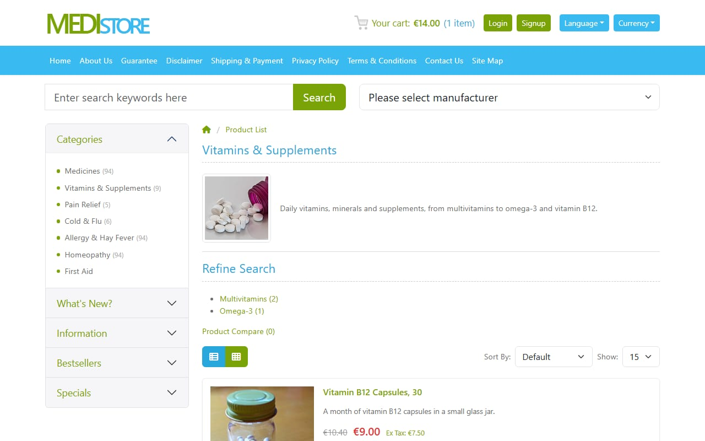

# Medistore: free pharmacy and drugstore website template (HTML5, Bootstrap 5)

An online pharmacy and health store template, by
[ThemeVault](https://www.themevault.net/?utm_source=github&utm_medium=referral&utm_campaign=medistore).
It's the most downloaded template in our ecommerce collection.

**[Live demo](https://demo.themevault.net/medistore/)** ·
**[Template page](https://www.themevault.net/medistore-medical-and-drugstore-html-web-template?utm_source=github&utm_medium=referral&utm_campaign=medistore)**

## What's in it

- **A full set of shop pages:** home, two category pages (grid and list views, sorting, a manufacturer filter in the
  search bar), a product page with reviews and related products, cart, checkout, login and register.
- **A checkout that works in the browser:** each step checks its required fields before opening the next one, and
  Confirm Order shows an order number. The cart and checkout totals add up.
- **Real pharmacy copy:** sixteen products with their own names, descriptions and prices, real category names and a
  brand filter, so you can see where your own text goes.
- **Bootstrap 5.3 with no jQuery:** a few lines of plain JavaScript (`js/main.js`) and a scroll-snap product strip
  with arrow buttons in place of the old carousel plugin.
- **Easy to re-skin:** colours, fonts and spacing are CSS custom properties at the top of `css/style.css`.
- **Light:** about 1.2 MB unpacked, Font Awesome 6 included locally.

## Use it

1. Download or clone this repository.
2. Replace the sample products, prices and categories with your own. The photos in this package are blurred
   placeholders: use your own product photos.
3. Upload the folder to any web host. It's plain HTML, CSS and JavaScript, with no build step.

**Taking real orders:** the cart and checkout show how buying works, but no order or payment reaches you until you
connect a payment or cart service and point the forms at a form service or your own server. If you sell medicines
online, check your country's rules on prescriptions and online pharmacy licensing first.

## Licence

**Free for personal and commercial use**, for your own or your clients' websites, as long as the "Medistore template
by ThemeVault" credit link in the footer stays in place. You can remove the credit for this template with a one-time
credit removal on the
[template page](https://www.themevault.net/medistore-medical-and-drugstore-html-web-template?utm_source=github&utm_medium=referral&utm_campaign=medistore),
or on every template with Pro.

This is **not an open-source licence**: you may not resell or redistribute the template, modified or not, as a
template or in a template collection. Full terms: [License.txt](License.txt) and
[themevault.net/license](https://www.themevault.net/license).

More free templates: [themevault.net](https://www.themevault.net/?utm_source=github&utm_medium=referral&utm_campaign=medistore)
